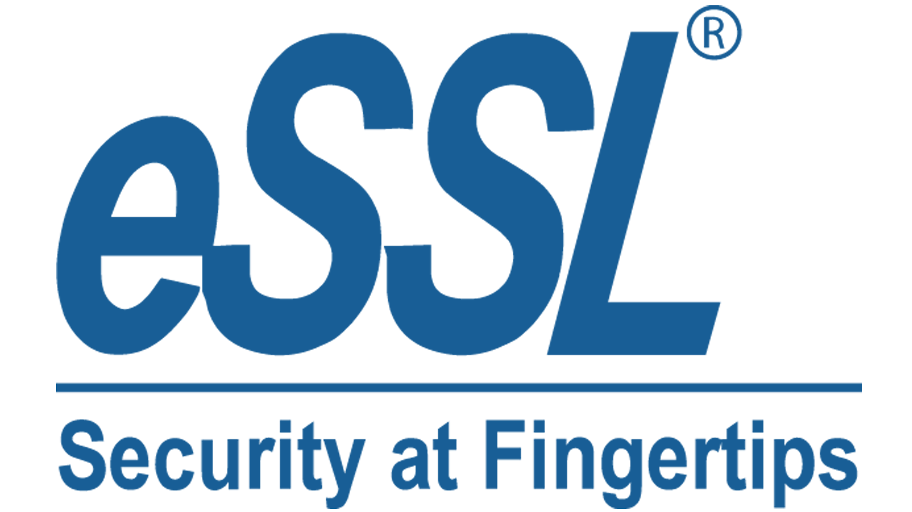

# Eastern Coalfields Limited (ECL) — eBios Portal
### Central Biometric Attendance, Workforce Gate Access Control & SAP SFTP Integration System

<p align="center">
  
</p>

[](https://dotnet.microsoft.com/)
[](https://dotnet.microsoft.com/apps/aspnet/web-apps/blazor)
[](https://www.postgresql.org/)
[]()

Enterprise biometric attendance, turnstile gate access control, shift scheduling, and daily SAP muster roll synchronization system designed for **Eastern Coalfields Limited (ECL)**, a subsidiary of Coal India Limited. The portal connects physical turnstiles, face recognition and fingerprint attendance machines across all **13 ECL Mining Areas** and colliery pits with central eBioServer SOAP WebServices and SAP ERP.

---

## 🏗️ System Architecture

The project is structured according to **Clean Architecture / Onion Architecture** principles with strict dependency isolation:

```
EbiosApp/
├── src/
│   ├── Ebios.Domain/          # Pure POCO Entities, Enums, and Core Business Rules (Zero Dependencies)
│   ├── Ebios.Application/     # Contracts, Interfaces, DTOs, and Audit Formatters (Depends only on Domain)
│   ├── Ebios.Infrastructure/  # EF Core, PostgreSQL, SOAP Client, SFTP Worker, Cryptography, SMTP
│   └── Ebios.Web/             # Blazor Interactive Server UI, Webhooks, Razor Components, Security
```

* **`Ebios.Domain`**: POCO entity models (`Employee`, `AttendanceLog`, `AttendanceDailySummary`, `Device`, `ShiftMaster`, `Area`, `SubArea`, `AuditLog`, `AppUser`).
* **`Ebios.Application`**: Use-case interfaces (`IAttendanceProcessingService`, `IDeviceService`, etc.), strongly-typed record DTOs, and safe audit snapshot formatters.
* **`Ebios.Infrastructure`**: PostgreSQL data access via `AppDbContext`, automatic schema initializer (`DbInitializer`), eBioServer SOAP integration (`EbiosSoapService`), SSH.NET SFTP transmission, PBKDF2 password hashing, and AES-256 webhook decryption.
* **`Ebios.Web`**: Interactive Blazor Server web application, minimal API webhook receivers (`/api/webhook/attendance`), photo streaming endpoints, and scheduled background workers.

---

## ⚡ Core Features & Capabilities

### 1. 📊 Real-Time Biometric Stream & Push Webhook
* **Webhook Receiver (`/api/webhook/attendance`)**: Ingests real-time turnstile punches pushed by remote eBioServer instances.
* **AES-256 Decryption**: Automatically decrypts payloads encrypted with 32-character keys, supporting all 3 eSSL/eBioServer IV handling strategies (Key-as-IV, Zero-IV, and Prepended-IV).
* **Unregistered Worker Identification**: Automatically captures punches from workers not yet onboarded, flags them (`IsFlagged = true`), associates them with the physical turnstile's pit, and provides one-click `➕ Onboard` capability.

### 2. ⏱️ Daily Attendance Muster Roll Engine
* **Overnight / Cross-Midnight Shifts**: Accurately matches next-morning exits (within 14 hours) to yesterday's night shift.
* **Shift Window Auto-Matching**: Matches punches to favorable shift windows (`[StartTime - 35m, StartTime + 90m]`) or explicit roster schedules.
* **Executive Single-Punch Exemption (`IsHigherAuthority`)**: Mining officers and executives are automatically granted full working hours on a single punch without requiring turnstile exit records.
* **Metrics Calculation**: Real-time evaluation of Total Hours, Overtime, Late Arrivals (with configurable grace periods), Early Exits, Half-Days, and Double Shifts.

### 3. ✏️ Manual Attendance Regularization & Audit Trail
* **Authorized Adjustments**: Officers can adjust punch times or assign shifts for missed or irregular punches.
* **Overwrite Protection**: Once manually regularized (`IsManuallyCorrected = true`), automated machine recalculations never wipe approved corrections.
* **One-Click Revert**: Authorizing officers can revert regularized records back to raw machine punch times anytime.
* **Strict Non-Repudiation Audit Trail**: Every change logs pre- and post-modification JSON snapshots, officer username, IP, timestamp, and reason under `/audit-logs`.

### 4. 🔒 Role-Based Access Control (RBAC) & Multi-Tenancy

| Role | Scope | Permissions & Capabilities |
| :--- | :--- | :--- |
| **SuperAdmin (ECL HQ)** | **Global (All 13 Areas)** | Full administrative authority across all Areas, Colliery Units, User Accounts, Terminal registrations, and Global System configurations. |
| **Area Personnel Manager (APM)** | **Mining Area Scope** | Authority over all colliery units within their assigned Mining Area. Restricted from editing workers or regularizing attendance outside their Area jurisdiction. |
| **Unit Personnel Manager (UPM)** | **Single Colliery Unit (Pit)** | View and operational access locked strictly to their assigned Colliery Unit. Attendance dropdowns, worker modifications, and terminal monitoring are locked to their pit only. |

### 5. 🚪 Turnstile Hardware Gate Access Control
* **Physical Device Blocking**: Send real-time hardware commands to biometric turnstiles via eBioServer SOAP API (`DeviceCommand_BlockUnBlockUser`).
* **Per-Gate Access Restriction**: Block or unblock specific workers from individual turnstile gates (e.g., Pit 1 Entry vs Workshop Gate) without disabling their master profile.
* **Terminal Management**: Hardware setup, activation code pairing, and online sync status.

### 6. 📋 Official Biometric Registration Template (ECL & WEBEL)
* **5-Photo Verification**: Complete digital physical registration form capturing Aadhaar card, Employee ID card, Live webcam photo, Biometric fingerprint template, and Signed physical hardcopy scan.
* **Live Webcam & Drag-and-Drop**: Capture live photos directly via browser camera or upload image files.
* **Witness Committee**: Records the 4-officer verification panel (ECL HR, ECL Security, WEBEL, and 4th witness).
* **Print & Export**: Built-in `@media print` stylesheet formats forms to A4 paper for physical signing and archival. Bulk print allows printing an entire colliery unit's forms in batch.
* **Batch Onboarding**: Bulk CSV particulars upload and bulk ZIP photograph import.

### 7. 📤 SAP ERP Synchronization via SFTP
* **Standardized CSV Export**: Generates attendance CSV matching SAP requirements:
  ```csv
  Employee Id,Attendance date,Capture_date in,Employee time in,Capture_date out,Employee time out,RFIC_card number,Biometric machine id
  ```
* **Automated Daily Transmission**: Nightly background worker (`SftpAttendanceSchedulerWorker`) triggers automated upload to SAP server at scheduled time (default `23:45`).
* **Remote Delivery Verification**: Verifies delivery by inspecting the remote file existence and byte size before marking the audit trail as `DELIVERED_VERIFIED`.
* **Manual Push & Test**: Officers can test SSH/SFTP connection and push daily attendance on demand.

### 8. 🛡️ Enterprise Security & Authentication
* **Two-Factor Authentication (2FA)**: Time-based One-Time Passwords (TOTP) compatible with Google Authenticator and Microsoft Authenticator. Generates live QR codes and 8 emergency recovery codes.
* **15-Minute Email OTP Password Resets**: Automated transactional emails with expiration timers.
* **SuperAdmin Break-Glass Access**: Emergency email-based root login bypass for disaster recovery.

---

## 💻 Tech Stack & Requirements

* **Runtime**: [.NET 10.0 SDK](https://dotnet.microsoft.com/)
* **Application Framework**: ASP.NET Core Blazor Interactive Server
* **Database**: PostgreSQL 14+
* **ORM**: Entity Framework Core 10 (`Npgsql.EntityFrameworkCore.PostgreSQL`)
* **External Communication**:
  * eBioServer SOAP 1.1 WebServices (`HttpClient`)
  * SAP Daily SFTP Sync (`SSH.NET`)
  * Two-Factor Authentication (`Otp.NET`, `QRCoder`)
  * Email Dispatcher (`System.Net.Mail` via TLS SMTP)
* **Styling**: Bootstrap 5, Bootstrap Icons (bundled offline in `wwwroot/lib/bootstrap-icons/`), Custom Responsive UI

---

## 🚀 Setup & Installation Guide

### Step 1: Clone the Repository
```bash
git clone https://github.com/Harsh15551/Ebios_ECL.git
cd Ebios_ECL
```

### Step 2: Configure Environment Variables
Copy the template file to `.env`:
```bash
cp .env.example .env
```
Open `.env` in any text editor and configure your local settings:
```env
# 1. PostgreSQL Database Connection
DB_CONNECTION_STRING=Host=localhost;Port=5432;Database=ecl_ebios;Username=postgres;Password=YOUR_POSTGRES_PASSWORD;Include Error Detail=true

# 2. eBioServer SOAP WebService Integration
EBIOS_URL=http://YOUR_EBIOS_SERVER_IP:82/webservice.asmx
EBIOS_USERNAME=essl
EBIOS_PASSWORD=YOUR_EBIOS_PASSWORD

# 3. eBioServer Webhook Decryption Key (32-character AES-256 key)
EBIOS_WEBHOOK_KEY=YOUR_32_CHAR_AES_KEY_HERE111111

# 4. Master Emergency Break-Glass Key for 2FA Override
EMERGENCY_2FA_OVERRIDE=ECL-MASTER-PASS-2026

# 5. SMTP Configuration (Password Resets & Admin Break-Glass OTPs)
SMTP_HOST=smtp.gmail.com
SMTP_PORT=587
SMTP_USER=your_email@gmail.com
SMTP_PASS=your_gmail_app_password
ADMIN_EMERGENCY_EMAIL=admin@ecl.gov.in

# 6. SAP SFTP Daily Attendance Sync Configuration
SFTP_HOST=192.168.0.50
SFTP_PORT=22
SFTP_USERNAME=sftp_user
SFTP_PASSWORD=sftp_password
SFTP_REMOTE_PATH=/SFTP/upload/
SFTP_SCHEDULE_TIME=23:45
SFTP_ENABLED=true
```

> ⚠️ **Security Notice**: `.env` is listed in `.gitignore` and must **never** be committed to version control.

### Step 3: Database Initialization
Ensure PostgreSQL is running on port 5432. You do **not** need to run manual migration scripts—when the application starts, `DbInitializer.cs` will:
1. Automatically create the `ecl_ebios` database and all tables if they do not exist.
2. Apply schema migrations idempotently.
3. Seed standard ECL Shift schedules (General, Shift 1, Shift 2, Night Shift).
4. Seed default ECL Mining Areas and initial test users.

### Step 4: Build & Run the Application
```bash
# Build the solution
dotnet build EbiosApp.slnx

# Run the web portal
dotnet run --project src/Ebios.Web/Ebios.Web.csproj
```

Open your browser and navigate to:
```text
http://localhost:5248
```

---

## 🔑 Default Seed Accounts (For Local Development)

When the database is created, the system seeds the following initial accounts:

| Role | Username | Password | Assigned Scope |
| :--- | :--- | :--- | :--- |
| **SuperAdmin** | `admin` | `pass@123` | **ECL HQ Global** (All 13 Mining Areas & Collieries) |
| **Area Admin (APM)** | `apm_salanpur` | `pass@123` | **Salanpur Mining Area Scope** |
| **Unit Manager (UPM)** | `upm_pit1` | `pass@123` | **Pit 1 / Dabur Colliery Unit Scope** |

> 🔒 **Recommendation**: After logging in, navigate to **Password** in the top navigation bar to change the default passwords.

---

## 📡 Configuring eBioServer Push Webhooks

To receive live biometric punches from physical SilkBio/turnstile terminals:

### 1. Expose Local Server for Testing (If using remote eBioServer)
Because eBioServer runs on a local network or remote IP, it must be able to reach your development endpoint. You can expose port 5248 using `localtunnel`:
```bash
npx localtunnel --port 5248
```
This generates a public URL (e.g. `https://ecl-ebios-test.loca.lt`).

### 2. Configure eBioServer Desktop Utility
1. Open the **eBioServer Desktop Application**.
2. Navigate to **Utilities** -> **Web Hook Settings**.
3. Set **Web Hook URL**:  
   `https://YOUR_TUNNEL_URL/api/webhook/attendance` (or `http://YOUR_SERVER_IP:5248/api/webhook/attendance` in production LAN).
4. Set **Encryption**:
   * If Enabled: Enter your 32-character AES key (must match `EBIOS_WEBHOOK_KEY` in `.env`).
   * If Disabled: Raw JSON punches will be received and processed directly.
5. Click **Save**.
6. Whenever an employee punches at a turnstile, the punch will stream instantly into the **Daily Attendance** console (`/attendance`).

---

## 📁 Repository Structure

```
├── .env.example                                  # Template for local environment configuration
├── README.md                                     # Project documentation
├── sample_bulk_regularization.csv                # Sample CSV for bulk attendance regularization
├── EbiosApp.slnx                                 # Visual Studio / .NET Solution definition
├── src/
│   ├── Ebios.Domain/                             # Pure Domain Models
│   │   └── Entities/                             # AppUser, Employee, AttendanceLog, ShiftMaster, etc.
│   │
│   ├── Ebios.Application/                        # Application Abstractions
│   │   ├── Common/                               # AuditSnapshotFormatter (masks passwords & sensitive IDs)
│   │   ├── DTOs/                                 # AttendanceDtos, DeviceDtos, EmployeeDtos, UserDtos, etc.
│   │   └── Interfaces/                           # IAttendanceProcessingService, IDeviceService, IAuditService, etc.
│   │
│   ├── Ebios.Infrastructure/                     # Data Access & External Integrations
│   │   ├── Data/                                 # AppDbContext, DbInitializer (auto-migrations & seeds)
│   │   ├── EbiosSoap/                            # EbiosSoapService (SOAP 1.1 WebService Client)
│   │   └── Services/                             # AttendanceProcessingService, EmployeeService, SftpService, etc.
│   │
│   └── Ebios.Web/                                # Blazor Presentation & API
│       ├── Components/
│       │   ├── Layout/                           # MainLayout, NavMenu, ReconnectModal
│       │   └── Pages/                            # Attendance, Employees, Devices, Shifts, Users, AuditLogs, etc.
│       ├── Endpoints/                            # WebhookEndpoints (/api/webhook/attendance), BiometricEndpoints
│       ├── Services/                             # SftpAttendanceSchedulerWorker, UserSessionService
│       ├── storage/biometric_forms/              # Local disk storage for employee photos & verification scans
│       └── wwwroot/lib/bootstrap-icons/          # Offline bundled Bootstrap Icons fonts
```

---

## 📄 License & Confidentiality

**Confidential & Proprietary.**  
Copyright © eSSL Security (Enterprise Software Solutions Lab). All Rights Reserved.  
Customized and developed for **Eastern Coalfields Limited (ECL)** / Coal India Limited.  
Unauthorized copying, distribution, or decompilation of this software via any medium is strictly prohibited.
